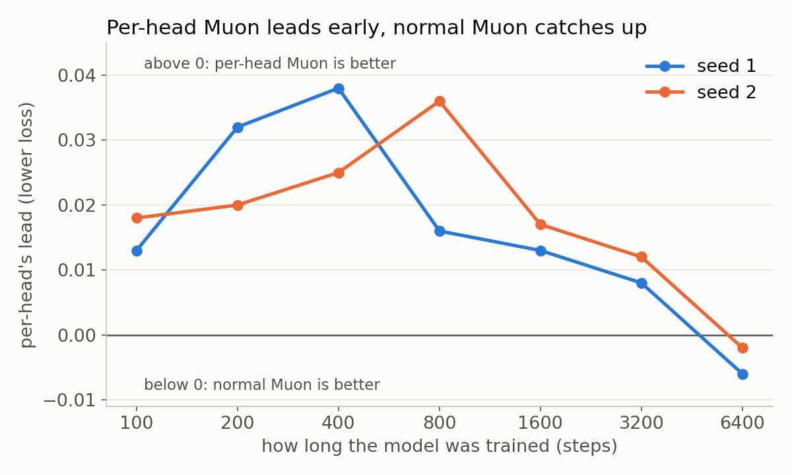
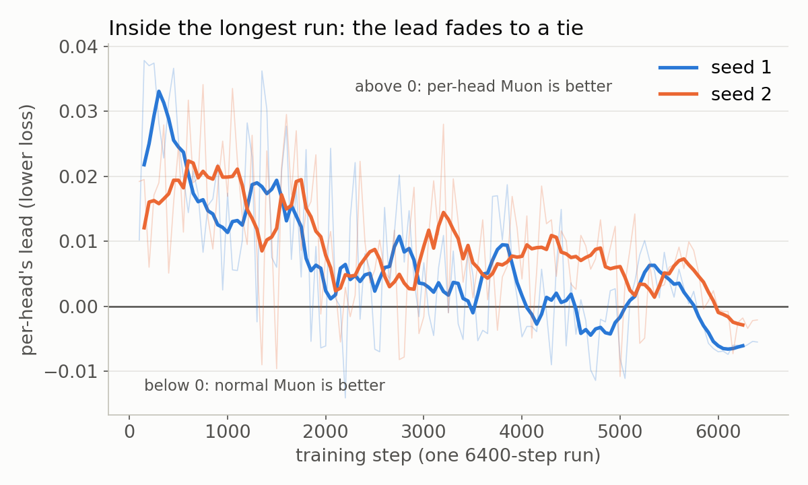

**Don't run per-head Muon like DeepSeek and Kimi unless you use MLA (multi-head latent attention).**

It seems to help only there, where the heads together are wider than the input.

I find that independent per-head Muon takes greedier steps (provable: each head picks its own best step).

So loss drops faster early.

But normal Muon catches up the longer you train, and in my longest runs they're about tied.

Kimi says per-head makes sure heads with small gradients still get a full-size update, instead of being drowned out by heads with big gradients.

In Kimi's model that's true, because their heads together are much wider than their input.

But in a standard transformer, normal Muon already gives every head approximately the same size update. There I think the gain comes mainly from the greedier early steps.

**When per-head makes sense:**

Your heads together are wider than their input, as in Kimi's and DeepSeek's attention designs.

You care about fast early progress, like short runs or quick experiments.

Only on Q and K. On V, I saw no gain.

**When it probably doesn't matter:** a standard transformer trained for a long time, where normal Muon ends up about the same.

This matches Group Muon (arXiv 2605.08933): per-head leads early, and normal Muon overtakes it later.

---

- [RESULTS.md](RESULTS.md): all numbers, the mechanism, ruled-out explanations, literature, and one command per script
- [toy/](toy/): toy model and experiments
- [lm/](lm/): byte LM trainer (`--perhead q,k`, `--ph_mode flat|pow:a|spec:top|spec:rand`)
- [chart.py](chart.py): draws both charts (long-run curves in [long_run_curves.json](long_run_curves.json))
