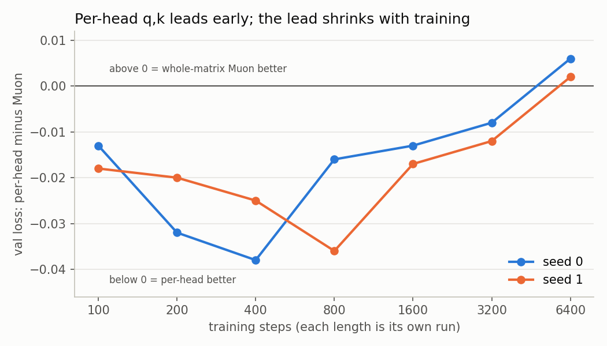

# Greedy heads: per-head vs whole-matrix Muon on attention q,k

Recent large models orthogonalize the attention q and k updates per head instead of as one matrix. Is that better, and why?

| setting | per-head q,k early | per-head q,k late |
|---|---|---|
| byte LM, 4 layers, width 64, QK-norm | ahead: -0.02 to -0.04 val loss at 100-800 steps | lead shrinks: -0.008 / -0.012 at 3200; Muon +0.006 / +0.002 at 6400 (within noise) |
| toy 2-layer attention model, task "token 4 back" | ahead at steps 10-70 | about 20 steps slower to solve: its early steps crowd heads onto the same input directions (a path effect, not worse steps) |

- [RESULTS.md](RESULTS.md): all numbers, the mechanism, ruled-out explanations, literature, and one command per script
- [toy/](toy/): toy model and experiments
- [lm/](lm/): byte LM trainer (`--perhead q,k`, `--ph_mode flat|pow:a|spec:top|spec:rand`)
